<div dir="rtl">

# نظام الدعم الفني (Help Desk PWA)

نظام تذاكر دعم فني باللغة العربية (RTL)، يعمل من المتصفح ويُثبَّت على الهاتف كتطبيق (PWA) مع إشعارات فورية.
مبني ليكون **عاماً**: أي مؤسسة (شركة، مدرسة، مستشفى، جامعة...) تضع اسمها وشعارها ولونها من صفحة الإعدادات، بدون تعديل الكود.

<p align="center">
  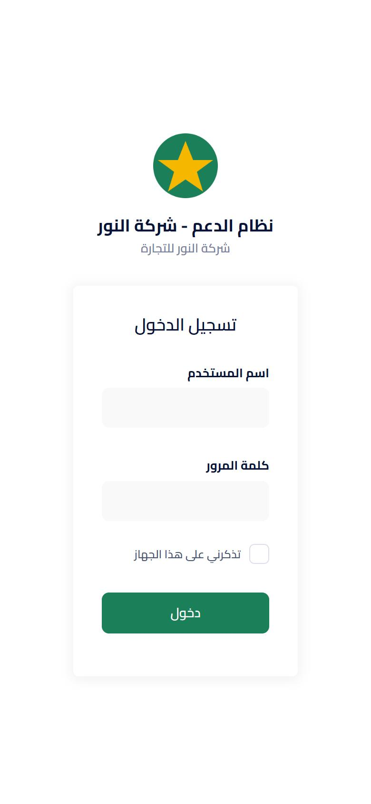
  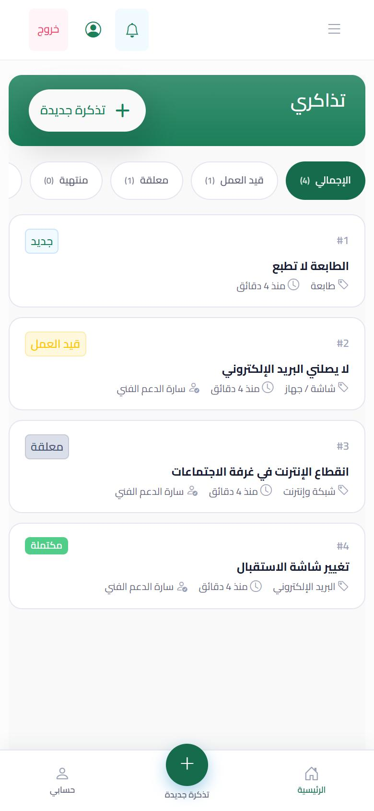
  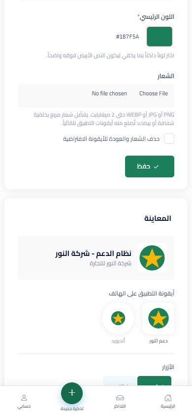
</p>

## المزايا

- **تذاكر كاملة:** فتح تذكرة مع صور ومرفقات (تُصغَّر الصور تلقائياً)، محادثة، حالات (جديد، قيد العمل، معلقة، منتهية، مكتملة)، تأكيد الحل من صاحب التذكرة أو إعادة فتحها، ملاحظات داخلية، طباعة، تقارير PDF/Excel.
- **أدوار:** موظف، دعم فني (أدمن) لكل قسم، مشاهد، ومدير نظام (root).
- **أقسام رئيسية وفرعية وأنواع مشاكل**؛ كل نوع مشكلة يذهب لقسم.
- **فروع (اختياري):** الأدمن المرتبط بفروع يرى فقط تذاكر موظفي فروعه. ولكل فرع نطاقات شبكة اختيارية تُظهر من أي فرع فُتحت التذكرة.
- **هوية المؤسسة:** اسم النظام، الاسم المختصر، اسم المؤسسة، اللون الرئيسي، والشعار. **أيقونات التطبيق تُصنع من الشعار تلقائياً.**
- **تسجيل الدخول:** حسابات محلية افتراضياً، و**LDAP / Active Directory اختياري** (يُفعّل من `.env`).
- **PWA:** تثبيت على أندرويد وآيفون، صفحة شرح التثبيت `/install`، صفحة عند انقطاع الاتصال، شريط تنقل سفلي للهاتف.
- **الإشعارات:** داخل النظام (الجرس)، فورية عبر Reverb (اختياري)، و**إشعارات الهاتف (Web Push)**.
- **الخصوصية:** الـ Service Worker يخزّن الملفات الثابتة فقط، ولا يخزّن أي بيانات تذاكر على الجهاز.

## التشغيل السريع (للتجربة)

المتطلبات: PHP 8.2+ (مع `gd`, `pdo_sqlite` أو `pdo_mysql`, `zip`, `mbstring`)، Composer، Node 20+.

```bash
git clone <repo-url> helpdesk && cd helpdesk
composer install
npm ci && npm run build
cp .env.example .env
php artisan key:generate
# للتجربة: قاعدة SQLite
#   DB_CONNECTION=sqlite  (واحذف/علّق DB_DATABASE)  ثم:  touch database/database.sqlite
php artisan helpdesk:install        # قاعدة البيانات + الأدوار + اسم المؤسسة + حساب مدير النظام
php artisan serve
```

افتح `http://127.0.0.1:8000` وادخل بحساب مدير النظام الذي أنشأته.

بيانات تجريبية (اختياري، لا تعمل في production):

```bash
php artisan db:seed --class=DemoSeeder
```

## الإعداد بعد التثبيت

1. **الإعدادات** (`/admin/settings`): الاسم، اللون، الشعار.
2. **الأقسام** و**أنواع المشاكل** (`/admin/departments`, `/admin/categories`).
3. **الفروع** (`/admin/branches`) — فقط إذا كان لديكم أكثر من موقع.
4. **المستخدمين** (`/admin/users`): أضف الموظفين وفريق الدعم، واربط الأدمن بأقسامه.
5. **إشعارات الهاتف:** أنشئ مفاتيح VAPID مرة واحدة ثم أعد تحميل الإعدادات:

```bash
php artisan webpush:vapid
php artisan config:cache
```

> إشعارات الهاتف تحتاج **HTTPS** (أو localhost). على آيفون تعمل بعد تثبيت التطبيق على الشاشة الرئيسية (iOS 16.4+).

## الإعدادات من `.env`

| المتغير | الوصف |
|---|---|
| `HELPDESK_NAME`, `HELPDESK_SHORT_NAME`, `HELPDESK_ORGANIZATION`, `HELPDESK_PRIMARY_COLOR` | القيم الافتراضية للهوية، حتى يحفظ المدير قيمه من صفحة الإعدادات |
| `LDAP_ENABLED` | `true` لتفعيل الدخول بحساب Active Directory |
| `LDAP_HOST`, `LDAP_PORT`, `LDAP_DOMAIN`, `LDAP_BASE_DN` | بيانات خادم AD؛ المستخدم يدخل بـ `username@LDAP_DOMAIN` |
| `LDAP_PROTECTED_DN` | (اختياري) مستخدمون داخل هذا الـ DN لا تُحدَّث فروعهم ومكان عملهم من AD |
| `VAPID_PUBLIC_KEY`, `VAPID_PRIVATE_KEY`, `VAPID_SUBJECT` | مفاتيح إشعارات الهاتف |
| `BROADCAST_CONNECTION` | `reverb` للتحديث الفوري في المتصفح، أو `log` لإيقافه |
| `APP_TIMEZONE` | المنطقة الزمنية، مثل `Asia/Riyadh` |

**LDAP:** الحسابات المحلية تعمل دائماً. عند تفعيل LDAP، أي مستخدم ليس له حساب محلي يُتحقق منه في AD ويُنشأ حسابه تلقائياً كموظف عند أول دخول، ويُربط بالفروع التي يطابق اسمها إحدى وحداته التنظيمية (OU).

## النشر على خادم

راجع [docs/DEPLOYMENT.md](docs/DEPLOYMENT.md) (Ubuntu + Nginx/Apache + HTTPS).

## الاختبارات

```bash
php artisan test
```

## صور الشاشات

| | | |
|---|---|---|
| 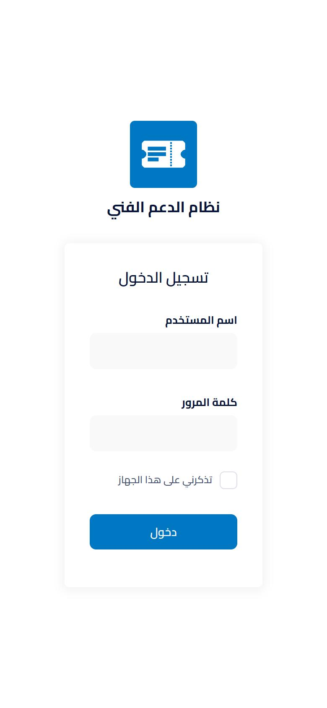<br>الدخول (الهوية الافتراضية) | <br>الدخول بعد تغيير الهوية | <br>الإعدادات والمعاينة |
| 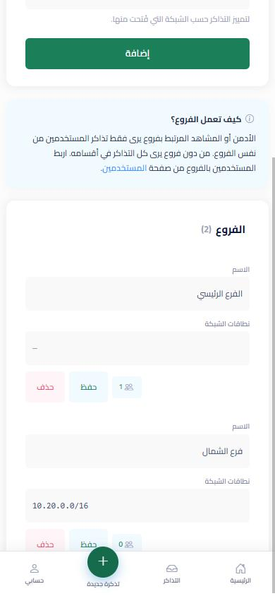<br>الفروع ونطاقات الشبكة | 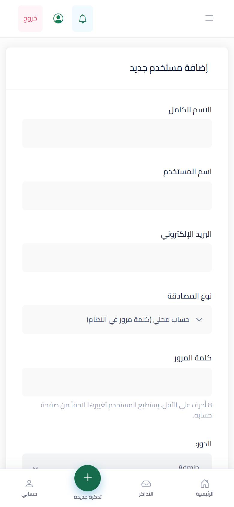<br>إضافة مستخدم محلي | <br>تذاكري |
| 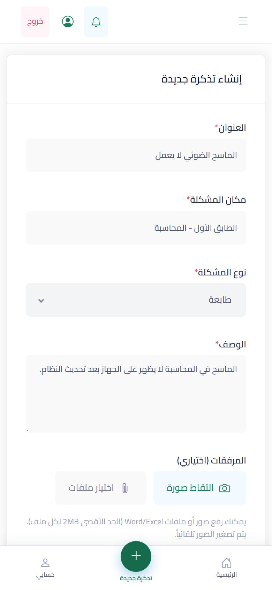<br>تذكرة جديدة (المكان يُعبّأ تلقائياً) | 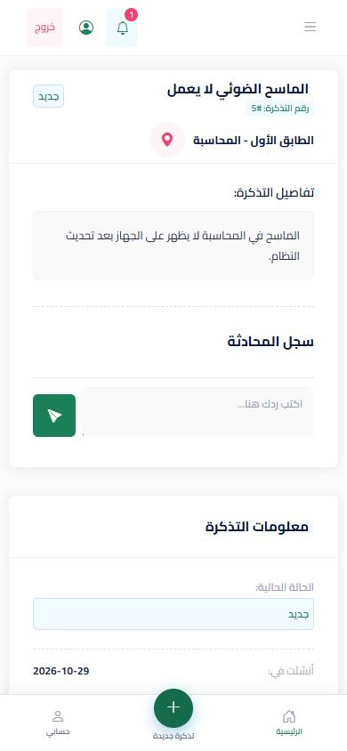<br>تفاصيل التذكرة | 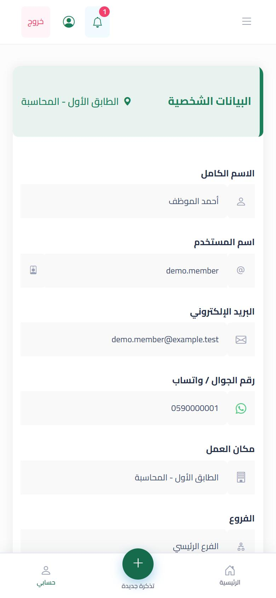<br>حسابي |
| 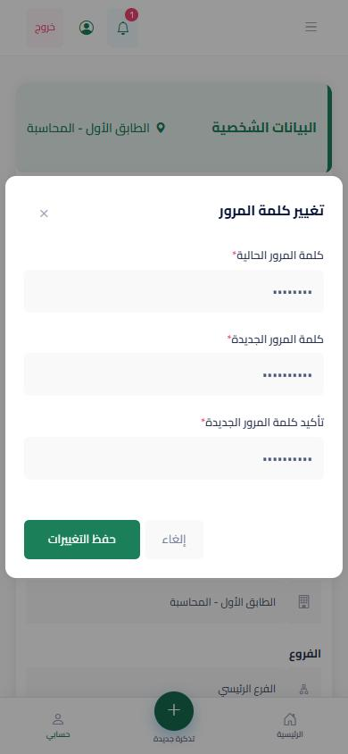<br>تغيير كلمة المرور | 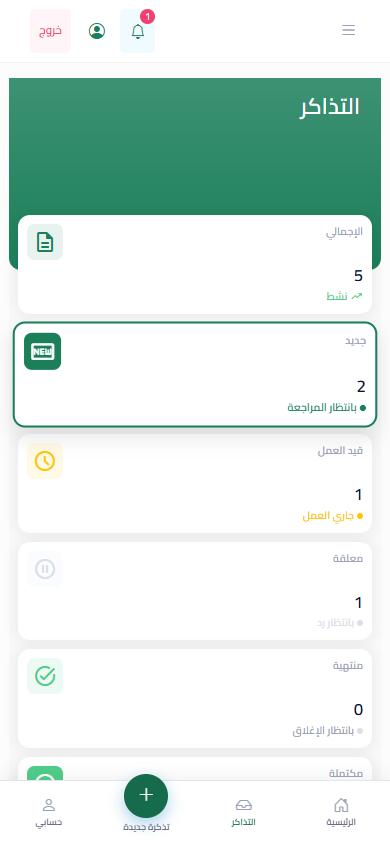<br>تذاكر الدعم الفني | 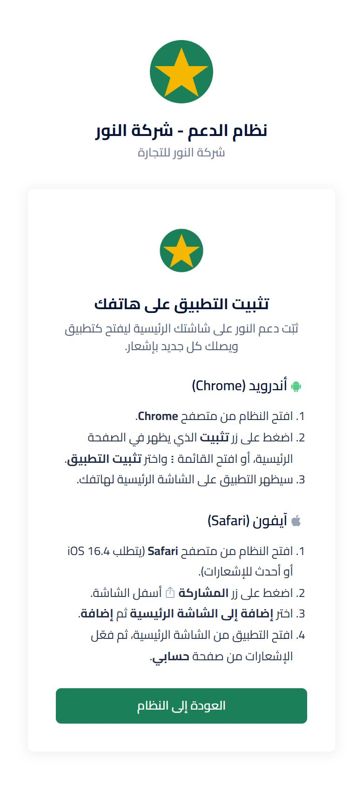<br>شرح التثبيت على الهاتف |

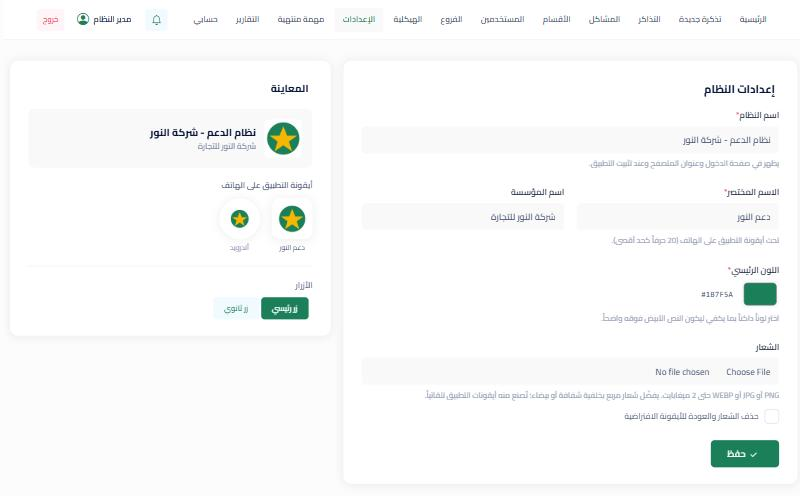

</div>

---

### English summary

Arabic (RTL) help desk / ticketing system built with Laravel 12, installable as a PWA with web push. White-label: each organisation sets its name, colour and logo from **Settings** (app icons are generated from the logo). Local accounts by default, optional LDAP/Active Directory sign-in, optional multi-branch scoping. Set up with `php artisan helpdesk:install`; see [docs/DEPLOYMENT.md](docs/DEPLOYMENT.md).
